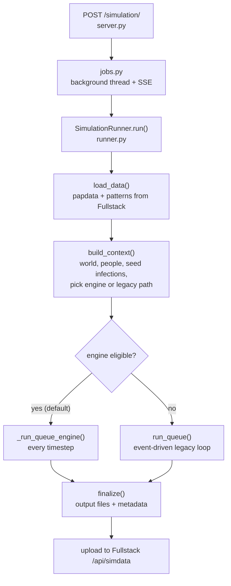
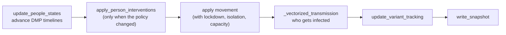

# Deep dive: how the simulation engine works

This page walks through one simulation run inside this repo: what's loaded,
what happens at each timestep, how transmission is computed, and how the DMP
decides what happens to each infected person. Read the
[README](../README.md) first for how to run things. The data formats going in
and out are in
[Data formats](https://github.com/Delineo-Disease-Modeling/Deploy/blob/main/docs/DATA_FORMATS.md).

Everything here describes the code as of October 2026. If you change the
behavior, update this page in the same PR.

## The shape of a run



`jobs.py` runs the simulation in a background thread and streams progress
messages to the browser while it runs. `simulate.run_simulator()` is a thin
wrapper around `SimulationRunner(...).run()`. All the real work is in
`runner.py` and the modules it calls.

## 1. Setup

**Random seeds (`_seed_random`).** With `random_seed` set, both Python's and
NumPy's random generators are seeded with it. Otherwise `randseed: false` seeds
them with 0, and `randseed: true` (the default) leaves them unseeded. Several
parts deliberately use **their own** random streams, so that turning a
feature on doesn't shift the numbers drawn everywhere else:

- intervention compliance thresholds (a fixed `random.Random(0)`)
- the engine's movement-intervention draws (a NumPy generator on a separate
  stream)

**Loading (`load_data`).** The runner downloads papdata and patterns in one
stream from Fullstack. If the request lists `disabled_poi_ids`,
`disabled_poi.py` rewrites the patterns first, so visits to those places become
time at home.

**Building the world (`build_context`).**

1. `world.build_locations` creates a `Household` for every home and a
   `Facility` for every place, with its floor area and catchment fraction.
2. `world.seed_population` creates a `Person` for every person, attaches them to
   their household, and gives each one an **intervention threshold**. The
   thresholds are spread evenly from 0 to 1 and shuffled. Someone complies with
   a mask or vaccine policy when their threshold is at or below the policy
   level, so raising the level from 30% to 50% keeps the same 30% and adds 20%
   more. It never picks a fresh random 50%.
3. The initial infections are seeded: either the listed `initial_infected_ids`
   or `initial_infected_count` random people. With `seed_age_spread_days > 0`,
   each seed's infection is backdated by a random amount up to that many days,
   so some are already infectious at the start (this mimics joining an epidemic
   mid-wave). By default every seed starts at time 0.
4. The runner decides between the **engine** and the **legacy path** (next
   section).

## 2. Engine vs legacy path

There are two implementations of the main loop.

| | Engine (default) | Legacy path |
| --- | --- | --- |
| Where | `_run_queue_engine` in `runner.py`, plus `membership.py` | `run_queue` + `event_queue.py` + `interventions.move_people` |
| Data structure | NumPy arrays, one slot per person ("struct of arrays", SoA) | Python dicts of `Person`, `Household`, `Facility` objects |
| Loop | Every timestep | Jumps between timesteps where something infectious happens |
| Transmission | `_vectorized_transmission` | `process_infection_event` (pairwise or aggregate) |
| Fractional dwell, external FOI | Supported | **Not supported**: a warning is logged and the setting has no effect |

The engine runs whenever the run is **eligible** (`_engine_eligibility`):

- the aggregate transmission kernel is on (`DELINEO_AGG_TRANSMISSION`, default on),
- per-contact logging is off (it always is for server runs),
- there's exactly **one variant**.

Multi-variant runs fall back to the legacy path. `DELINEO_SOA_ENGINE=0` forces
the legacy path for every run. `DELINEO_SOA_SHADOW=1` runs consistency checks
between the engine's arrays and the object model (`engine_shadow.py`). It's
meant for debugging and is slow.

The rest of this page describes the engine, since that's what production runs.

## 3. One timestep in the engine

A timestep is 60 minutes, and timestep keys are minutes from the start. The
loop in `_run_queue_engine` goes from `ts = 60` to the run `length`, and does
this at each step:



1. **Advance disease states.** For each person with a timeline,
   `Person.update_state` sets their state bits to every state whose time window
   covers this timestep (see [section 5](#5-the-dmp-what-happens-after-infection)).
   People between transitions are skipped cheaply.
2. **Per-person interventions** (`interventions.apply_person_interventions`).
   These only run when the active intervention row changed. Masks follow the
   threshold rule above and can be taken off again if the level drops.
   Vaccination is permanent: a person gets 1-2 doses the first time they
   qualify.
3. **Movement.** Each person is placed where the patterns say they are this
   hour. When the run has a lockdown, self-isolation, or capacity limit (or any
   place has a listed capacity), `apply_movement_with_interventions` applies
   them in this order:
   - **Lockdown:** each trip to a place draws once when it starts. If the draw
     is below the lockdown level, the whole trip is spent at home.
   - **Self-isolation:** a symptomatic person stays home while their compliance
     draw is below the `selfiso` level.
   - **Capacity:** a place admits at most `ceil(capacity × multiplier)` people.
     People already inside keep their spot. Extra arrivals are sent home and try
     again next hour.

   Intervention levels are re-read every timestep. An intervention's `time` is
   in **hours** (it's multiplied by 60 internally), unlike the run `length`,
   which is in minutes.
4. **Transmission** (next section).
5. **Bookkeeping and output.** The runner records state changes and newly
   infected people, then writes this timestep to the output files.

## 4. Transmission: Wells-Riley

Delineo uses the **Wells-Riley** model of airborne infection. It treats every
room as **well mixed**: everyone in a room shares the same air, and distance
inside the room doesn't matter.

For a susceptible person in a room for one hour, the chance of being infected
is:

```text
P(infection) = 1 - exp(-dose)

dose = base_quanta[room] × W[room] × intake[person]

base_quanta[room] = (q × p × t) / Q[room]
    q = 20     quanta emitted per hour by one infectious person
    p = 0.5    breathing rate, m³ per hour
    t = 1      exposure time, hours (one timestep)
    Q          ventilation, m³ per hour (below)

W[room] = sum over infectious people in the room of
          (0.30 if masked, else 1.0) × (1 - vaccine transmission protection)

intake[person] = (0.50 if masked, else 1.0) × (1 - vaccine infection protection)
```

In plain terms: each infectious person adds infectious particles to the room.
Masks cut what they emit by 70%, and vaccination cuts it further. Ventilation
removes particles, so larger, better-ventilated rooms are safer. Each
susceptible person's dose is then reduced by their own mask (50%) and
vaccination. One random draw per exposed susceptible person decides whether
they're infected.

**Ventilation `Q`:**

- Homes always use `Q = 150`.
- With **area-aware ventilation** (`DELINEO_AREA_VENTILATION`, default on), a
  place uses `Q = ventilation_coeff × area`. The area is clamped to between 65
  and 70,000 m², and `ventilation_coeff` defaults to 9.0. Places with no
  known area fall back to 150. This makes small, crowded places riskier per
  person than large ones.

**Vaccine protection** (`infection_models/v6_wells_riley.py`): 65% against
infection and 40% against transmission by default. The file also has a waning
formula, but nothing in the simulator ever calls `update_vaccination_time`, so
in practice **protection never wanes** during a run.

**Who can be infected or infect others:**

- Only people with the **infectious** bit can infect others.
- People who are hospitalized, recovered, or removed are skipped on both
  sides. Hospitalized people still appear in movement, but they don't take part
  in transmission.
- Only people who have never been infected can be infected. There is no
  reinfection.

**Fractional dwell** (`DELINEO_FRACTIONAL_DWELL`, default on, engine only). If
the patterns say someone spends only 20 minutes of an hour at a place, they
emit and inhale there for 20/60 of the hour and at home for the other 40/60.
When they're infected, the infection is attributed to the place or the home in
proportion to each one's share of their dose.

**External force of infection** (`DELINEO_EXTERNAL_FOI`, **off** by default,
engine only). Most real visitors to a place live outside the zone, and the
simulation doesn't model them. When this setting is on, each place gets extra
"background" emission in proportion to `(1 - f_j) / f_j × external_prevalence`,
where `f_j` is the place's catchment fraction. `external_prevalence` defaults to
0, so the term does nothing until someone calibrates it.

**Why "aggregate"?** The older pairwise kernel computed a dose for every
(infectious person, susceptible person) pair. The aggregate kernel sums all
the emission in a room first, which is mathematically the same because
`1 - Π exp(-λᵢ) = 1 - exp(-Σ λᵢ)`. But it draws random numbers in a different
order, so its output is **statistically equivalent, not byte-identical**.
`scripts/equivalence_ensemble.py` checks this by comparing many runs of each,
and `tests/test_aggregate_transmission_equivalence.py` guards it.

## 5. The DMP: what happens after infection

When someone is infected, `InfectionManager.schedule_infection`
(`infectionmgr.py`) builds their **timeline**: when they enter each disease
state.

**Where the timeline comes from**, in priority order (`create_timeline`):

1. **A custom matrix CSV** for this variant, if the request included one
   (`matrix_csv_by_variant`, uploaded through Fullstack's DMP matrix manager).
2. **The DMP state machine, in-process** (`dmp_inprocess.py`). The person's
   demographics (age, sex, vaccination status, variant) select a state machine
   from the SQLite database `dmp/app/state_machine/state_machines.db`. Then one
   random path is sampled through it. The matching and matrix conversion is
   cached per demographic group, about 200 of them; only the sampling runs per
   person.
3. **The DMP over HTTP** (`POST {DMP_API_URL}/simulate`), only if the
   in-process DMP couldn't be loaded.
4. **A fallback timeline** from `config.py`: infected, then infectious after 4
   hours, then recovered after 24 hours. **It never includes hospitalization or
   death.**

`dmp_mode` controls how strict this is. `auto` (the default) quietly uses the
fallback when the DMP misses. `required` raises an error instead. `off` always
uses the fallback. Every run's metadata records how many timelines came from
the DMP and how many came from the fallback (`timeline_source_counts`). **Check
it before you trust a run's hospitalization or death numbers.**

**From DMP states to state bits.** DMP state names map to `InfectionState`
bits through `DMP_API["state_mapping"]` in `config.py`:

| DMP state | Bits |
| --- | --- |
| Infected | INFECTED |
| Infectious_Asymptomatic | INFECTIOUS |
| Infectious_Symptomatic | INFECTIOUS + SYMPTOMATIC |
| Hospitalized, ICU | HOSPITALIZED |
| Recovered | RECOVERED |
| Deceased | REMOVED |

`_build_sequential_timeline` turns the DMP's list of state changes into one
time window per state, each ending one minute before the next begins. The
final state lasts for the rest of the run. Timelines must be **monotonic**: a
state can't come back after a different state. A state machine with relapse
raises an error instead of being silently mis-simulated.

## 6. Output

Each timestep, `write_snapshot` appends to two gzip JSON files, written
incrementally so they never sit fully in memory (`io.py`, `snapshots.py`):

- `simdata.json.gz`: each ever-infected person's current state bits
- `patterns.json.gz`: per-location counts, each person's location, and where
  infections happened

`finalize()` adds the run's `metadata`. `jobs.py` then uploads everything to
Fullstack. The exact shapes are in
[Data formats](https://github.com/Delineo-Disease-Modeling/Deploy/blob/main/docs/DATA_FORMATS.md#5-run-output).

One quirk to know about: in the timestep when someone is newly infected, the
engine records them as `3` (infected + infectious). From the next timestep on,
their value follows their DMP timeline, which usually starts with infected (`1`)
only.

## Known issues and open questions

- **The HTTP DMP fallback seems to get the time units wrong.** The DMP returns
  times in hours. The in-process path converts them with `hours × 60`, but
  `_build_timeline_from_response` (the HTTP path) uses `time / 60`. If the HTTP
  path is ever used, timelines would come out 3,600 times too short. No test
  covers this path.
- **The transmission level isn't calibrated.** `ventilation_coeff` (9.0) is a
  physical estimate, as the comment in `config.py` says. Relative comparisons
  between scenarios are more trustworthy than absolute attack rates. See
  [Model assumptions](https://github.com/Delineo-Disease-Modeling/Deploy/blob/main/docs/MODEL_ASSUMPTIONS.md).
- **Multi-variant runs use the slower legacy path,** which doesn't support
  fractional dwell or external FOI.
- **Vaccine waning is never applied** (see section 4).
- **Hospitalized people keep moving.** They're excluded from transmission, but
  they still follow their movement schedule, so they appear at places on the
  maps.

## Where to start reading the code

1. `simulator/runner.py`: `run()`, then `build_context()`, then
   `_run_queue_engine()`
2. `simulator/transmission.py`: `_vectorized_transmission()`
3. `simulator/membership.py`: the array store and `apply_movement_with_interventions()`
4. `simulator/infectionmgr.py`: `create_timeline()`
5. `simulator/config.py`: every default and env var mentioned above

Tests that pin down this behavior: `test_engine_*.py`,
`test_aggregate_transmission_equivalence.py`, `test_fractional_dwell.py`,
`test_external_foi.py`, `test_natural_history.py`, `test_incidence.py`.
